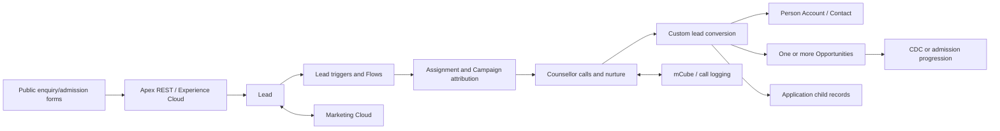
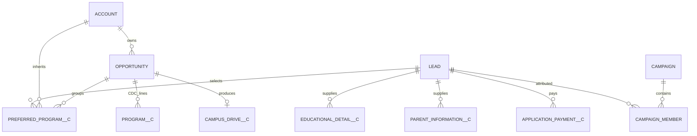
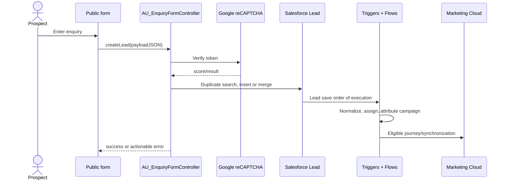
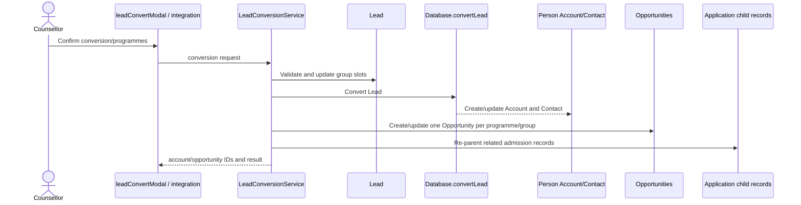
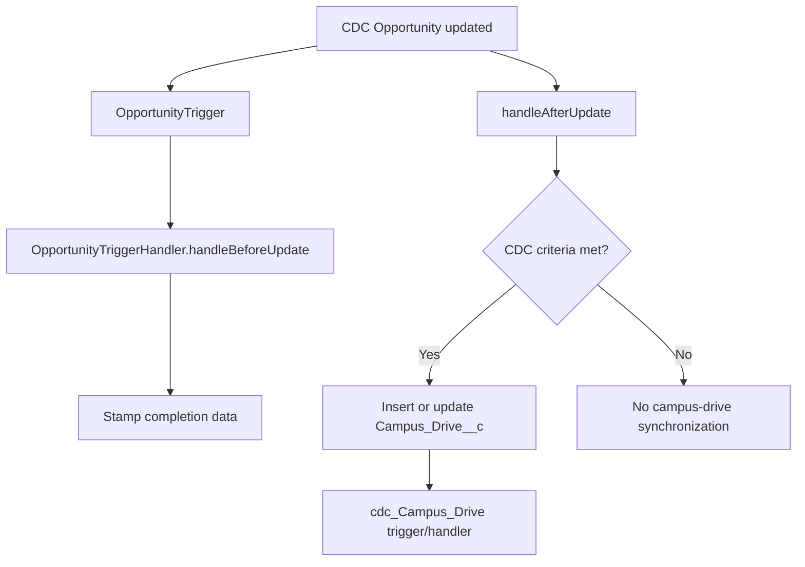

# Ahmedabad University Salesforce Sales Cloud — Project Knowledge Transfer

> **Evidence date:** 14 October 2026  
> **Primary source:** Production org `au-prod` (`00D5g00000Ioh0WEAR`)  
> **Connected user:** `salesforce.admin@ahduni.edu.in`  
> **Org:** Ahmedabad University, Enterprise Edition, Production  
> **Document purpose:** Beginner-friendly functional and technical orientation for development, support, debugging, and safe enhancement.

## Evidence and confidence model

This document deliberately separates facts from interpretation:

| Marker | Meaning |
|---|---|
| **ORG-VERIFIED** | Confirmed directly through a read-only Production API/Tooling/Metadata query. |
| **ORG+LOCAL VERIFIED** | The component exists in Production and the relevant local source is an exact or substantively matching copy. |
| **LOCAL-SUPPORTING** | Observed in the repository, but the local repository is not the source of truth. Re-query or retrieve the component before changing it. |
| **INFERRED** | A reasoned business interpretation from names and implementation; a product owner must confirm it. |
| **UNVERIFIED** | The available read-only query did not provide enough evidence. |

No tests, Flows, Apex, deployments, anonymous Apex, jobs, data mutations, Git operations, or metadata writes were executed during this analysis. Production source was queried into process memory only. The only created artifact is this document.

### Important repository drift

The Production org contains 66 unmanaged Apex classes, 10 unmanaged triggers, and 6 unmanaged LWCs. Every Production Apex class and trigger also has a local file, but the following files differ substantively from Production:

`AU_EnquiryFormController`, `AU_FormAdminController`, `AU_FormAdminController_Test`, `cdc_Campus_DriveHandler`, `cdc_Campus_DriveHandlerTest`, `CDCProgramLinesController`, `LeadAssignmentForUnderGraduation`, `LeadConversionService`, `LeadConversionServiceTest`, `LeadConvertController`, `LeadHelper`, `LeadPhoneUpdater`, `LeadTriggerHandler`, `OpportunityStageUpdater`, `OpportunityTriggerHandler`, `saveWebTo_YourProfileData`, `saveWebTo_YourProfileData_Test`, and trigger `cdc_Campus_Drive`.

Therefore, code excerpts below explain the architecture but must not be copied into a change without a fresh, non-destructive Production retrieve into an isolated comparison directory.

---

## 1. Project Overview & Business Purpose

### What this Salesforce org does

**ORG-VERIFIED / INFERRED:** This is an education recruitment, admissions, applicant-management, outreach, and career-development platform built on Sales Cloud. Its central lifecycle is not a conventional product sale. A person begins as a `Lead`, submits one or more enquiry/application forms, is routed to the appropriate academic team, is nurtured through calls and Marketing Cloud, and is ultimately converted into a Person Account/Contact plus one or more Opportunities representing programme applications.

The implementation supports multiple Ahmedabad University business areas through record types:

- Undergraduation
- Masters
- PhD
- Executive Education
- Career Development Centre (`CDC`)
- CLeF
- Graduation/legacy pathways
- Fundraising/NPSP opportunity types such as Donation, Grant, Major Gift, Matching Gift and Membership

The most important business capability is **multi-programme admissions**. One prospective student can express interest in several programmes or programme groups. Custom Apex stores and converts those preferences, creates appropriate Opportunities, and migrates related application information from Lead-linked custom records to Account/Opportunity-linked records.

### Main user groups

| User group | Likely responsibilities | Evidence |
|---|---|---|
| Admissions counsellors | Review enquiries, call applicants, update status, convert qualified Leads | Lead conversion/call-log components and admission record types |
| Programme/department teams | Work Leads for UG, Masters, PhD and Executive Education | Record types and assignment metadata |
| Marketing team | Campaign attribution, Marketing Cloud journeys, WhatsApp and lead-source management | MC Connect package, campaign logic and desynchronisation Flows |
| Form administrators | Configure public enquiry forms and programme brochures | `auFormAdminPanel`, `AU_FormAdminController` |
| Applicants/prospects | Submit public enquiry/admission forms and possibly use Experience Cloud | REST controllers and Communities controllers |
| CDC users | Manage campus-drive programmes, employer accounts and placement metrics | CDC record types, `Campus_Drive__c`, `cdcProgramLines` |
| Tele-calling users | Initiate/receive calls and log outcomes | mCube components, `Call_Detail__c`, call-log LWCs |
| Integration users | Submit Auris/admission data and receive/query partner data | REST services and connected packages |

---

## 2. Salesforce Architecture & Technology Stack

### Platform stack

| Layer | Implementation |
|---|---|
| CRM data | Standard Lead, Account, Contact, Opportunity, Campaign, Campaign Member, Task and Event plus admission/CDC custom objects |
| UI | Lightning record pages, 6 custom LWCs, Aura telephony components, Experience Cloud/Sites controllers |
| Server logic | 66 unmanaged Apex classes and 10 unmanaged triggers |
| Automation | Unmanaged record-triggered and integration Flows plus managed Marketing Cloud Flows |
| Configuration | Custom Metadata Types for assignment, record-type mapping, web forms, field mapping, Opportunity routing and telephony |
| Integration | Apex REST, Named Credential for reCAPTCHA, Marketing Cloud Connect, WhatsApp managed package, mCube telephony and external applicant system (“Auris”) |
| Nonprofit capabilities | NPSP managed package (`npsp`, `npe01`, `npe03`, `npe4`, `npe5`, `npo02`) |
| API baseline | Project source API 65.0; connected org reports API 68.0; custom components range approximately API 51–66 |

### Managed-package footprint

**ORG-VERIFIED:** Apex class counts by namespace are:

| Namespace | Classes | Interpretation |
|---|---:|---|
| unmanaged | 66 | Ahmedabad University custom code |
| `npsp` | 1,035 | Nonprofit Success Pack |
| `et4ae5` | 519 | Marketing Cloud Connect |
| `V2_Wtsp_Con` | 25 | WhatsApp connector |
| other NPSP namespaces | 32 | NPSP supporting packages |

Managed code should be treated as a vendor dependency. Do not modify it; understand configuration and version impact instead.

### High-level architecture



---

## 3. Complete Business Processes & Workflows

### 3.1 Public enquiry capture

1. A prospect opens a department/form URL.
2. `AU_EnquiryFormController.getMetadata()` reads form definitions from Custom Metadata and builds a dynamic field model.
3. State/picklist values are supplied to the client.
4. The user submits JSON to `createLead()`.
5. The controller validates and maps the payload, verifies Google reCAPTCHA using Named Credential `GoogleReCaptcha`, and searches for duplicate Leads.
6. It either inserts a Lead or merges new information into a master Lead.
7. Lead assignment, phone normalisation, source attribution, campaign membership, and other record-triggered automation run.
8. A success/error response is returned to the form.

`AU_EnquiryFormController` is **drifted**, so its exact Production branch logic must be inspected before modification.

### 3.2 Legacy/configurable website lead API

`saveWebsiteLead` exposes `/services/apexrest/saveLead/*`. It uses `WebFormFieldMapping__mdt` and department/form information to create or update a Lead, then returns an HTTP response. The local class matches Production and contains an `upsert lead`, meaning duplicate/external-key behaviour must be understood before changing field mapping.

### 3.3 Auris/admission-profile synchronisation

`saveWebTo_YourProfileData` exposes `/services/apexrest/saveLeadRelatedData`. It accepts a large application payload, identifies or creates the Lead, updates programme-group slots, and creates related records such as:

- parent information;
- preferred programmes;
- education and college history;
- academic/test results;
- employment history;
- extracurricular activities;
- siblings and personal statements;
- documents and payments;
- professional awards and previous school.

It uses `Registration_Number__c` and other business keys for idempotency. Failures are intended to be recorded through `logFailedLead`. This class differs from local Production source and is a high-risk integration boundary.

### 3.4 Lead assignment and normalisation

Active triggers on Lead are `LeadCombinedTrigger`, `LeadMultiLeadSourceTrigger`, and `LeadTrigger`. Several older triggers (`LeadAssignmentTrigger`, `LeadPhoneTrigger`, `leadBeforeInsertLastName`, `UpdateCityLookupTrigger`) are inactive, suggesting consolidation was attempted but legacy code remains.

The active handler layer performs or delegates:

- department/programme-based owner assignment;
- round-robin tracking;
- country-code phone normalisation;
- initial field defaults and last-name fallback;
- most-recent source stamping;
- parent/child Campaign creation and Campaign Member attachment;
- multi-source/duplicate handling.

Assignment rules are configuration-driven through `Department_Record_Type_Mapping__mdt`, `LeadAssignmentConfig__mdt`, and tracker/configuration objects. Some code still queries Record Type names and contains duplicated overloads, increasing maintenance risk.

### 3.5 Counsellor call outcome

The quick-action LWC `callLogConfirmation` displays outcomes such as not connected, follow-up required, interested, not interested, converted and closed. It calls `CallLogController.updateLeadAndCreateTask`, which updates the Lead and creates an activity. `callLogModal` provides a simpler call-log form through `saveCallLog`.

The separate mCube integration supports outbound/inbound calls, uses `Mcube__mdt` values for API key/version/callback configuration, dynamically finds CRM records by phone, and inserts/updates `Call_Detail__c`.

### 3.6 Lead conversion

The `leadConvertModal` LWC calls `LeadConvertController.getLeadDetails`, allows an operator to select converted status, existing Account/Contact, whether to create an Opportunity, and Opportunity name, then calls `convertLead` and navigates to the resulting Account.

The larger REST/service conversion path is implemented by `LeadConversionService` at `/services/apexrest/LeadConversion`. It:

1. reads the Lead and programme-group payload;
2. validates status and conversion state;
3. resolves record-type mapping;
4. invokes `Database.convertLead`;
5. updates the Person Account with Lead/application data;
6. creates or updates multiple programme Opportunities;
7. creates Opportunity Contact Roles;
8. updates application-number tracking;
9. re-parents child application records to Account/Opportunity;
10. returns a structured response.

The conversion service is very large (Production body about 220,551 characters), differs from local source, and has direct DML and many queries. It is the highest-risk component in the custom codebase.

### 3.7 Opportunity progression

`OpportunityTrigger` delegates before/after update to `OpportunityTriggerHandler`. The handler stamps completion dates and creates/updates `Campus_Drive__c` records for CDC Opportunities.

`OpportunityStageUpdater` exposes `/services/apexrest/updateOpportunityStage`. It updates Opportunity stages/application data, Account integration timestamps, test scores, parent records, and UG Opportunity ownership using Custom Metadata round-robin/state rules.

### 3.8 Marketing lifecycle

Org-listed unmanaged Flows include:

- `Desync_the_Lead_From_Marketing_Cloud_When_its_Closed_Or_Disqualified`
- `Desync_the_Contact_From_Marketing_Cloud`
- Lead/Contact deletion-set Flows for Marketing Cloud
- `JBSystemFlow_Lead` and `JBSystem_Lead_RecordFlow`
- `WhatsApp_Event_Capture_FROM_MC`
- `Wonderchat_Lead_Submission_to_Activity`
- `Linkdin_Ads_Mapping`
- `Lead_Source_Overwrite_Prevent`
- phone and record-type update Flows
- unqualified-status automation

This means Lead updates may be processed by Apex triggers, multiple Flows, Marketing Cloud system automation and Campaign logic in the same transaction. Regression analysis must cover the combined order of execution.

---

## 4. Module-by-Module Functional Explanation

| Module | How it is used here | Key components |
|---|---|---|
| Lead | Primary prospect/applicant record; captures sources, departments, programmes, application identifiers and integration timestamps | Lead triggers/handlers, enquiry APIs, assignment and conversion services, many Flows |
| Account | Converted applicant, often a Person Account; also schools, organizations, CDC employers and NPSP households | Admission record types, NPSP, `Update_Account_Function` Flow |
| Contact | Person related to an Account; Marketing Cloud desync and Experience Cloud use cases | NPSP, communities controllers, contact MC Flows |
| Opportunity | A programme application, CDC engagement, or NPSP fundraising transaction depending on record type | conversion service, stage updater, Opportunity trigger, `cdcProgramLines` |
| Campaign | Marketing attribution hierarchy and membership | `LeadTriggerHandler.syncCampaignMembership` |
| Task/Event | Call outcomes, follow-ups, Wonderchat submissions and activities | Call-log components, `Call_Log_Activity`, `Event_Call_Status` |
| CDC | Employer/campus drive pipeline and programme/AOI lines | `Campus_Drive__c`, `Program__c`, CDC record types and components |
| Admission profile | Detailed applicant information received from Auris/forms | numerous Lead/Account/Opportunity child objects |
| Experience Cloud | Login, self-registration, profile and landing-page support | `Communities*`, `Site*`, `MicrobatchSelfRegController`, `MyProfilePageController` |
| Products/Quotes/Orders | No custom business-critical implementation was identified in the inspected Apex/LWC/Flow inventory | **UNVERIFIED** beyond absence in inspected custom logic |
| Fundraising | NPSP record types and managed automation coexist with admissions | NPSP packages and Opportunity fundraising record types |

---

## 5. Objects, Fields & Relationships

### Core relationship model



### Important custom objects

| Object | Purpose and notable fields |
|---|---|
| `Campus_Drive__c` | CDC placement metrics. Fields include `Account__c`, `Program__c`, `Academic_Year__c`, `Registered__c`, `Appeared__c`, `Shortlisted__c`, `Selected__c`, `Offer_Count__c`, `CTC__c`, `Expected__c`, `External_Id__c`. |
| `Program__c` | CDC programme line related to Opportunity: `Opportunity__c`, `Program_Code__c`, `Full_Program_Name__c`, `Status__c`. |
| `Preferred_Program__c` | Applicant programme selection related to Lead, Account and/or Opportunity. |
| `Application_Payment__c` | Transaction reference, amount, status, source, bank, URL and relationships to Lead/Account/Opportunity. |
| `Parent_Information__c` | Parent relationship, contact, education, occupation and income details. |
| `Educational_Detail__c` | School/education history, board, stream, year, marks, percentage/CGPA and geography. |
| `College_Education__c` | Degree/diploma, institution, discipline, dates, marks and geography. |
| `Standardised_Test_Score_s__c` | Test, score, total, percentile, dates and applicant/application relationships. |
| `Call_Detail__c` | Telephony call ID, parties, phone numbers, duration, status, recording and CRM-parent links. |
| `Round_Robin_User__c` / trackers | Stores assignment progress. Exact active usage must be checked against metadata/configuration. |
| `Failed_Lead__c` or equivalent | Intended integration failure audit used by applicant-profile ingestion; verify exact object in Production before relying on it. |

### Record types

**ORG-VERIFIED:** Lead record types include `CDC`, `CLeF`, `Executive_Education`, `Graduation`, `Masters`, `Phd`, `Temp`, and `Undergraduation`. Account and Opportunity use parallel academic record types. Opportunity additionally contains NPSP/fundraising types and a generic `Opportunity` type. Account also contains `PersonAccount`, `HH_Account`, `Organization`, and `School` variants.

Record Type DeveloperName, not display label, should be used in code/configuration. Existing code sometimes queries `RecordType.Name`, which is brittle if labels change.

### Field-level caveat

The broad Production Custom Field catalog did not complete within the analysis window. Field names above are confirmed in locally supporting metadata and referenced by Production components, but a fresh Production describe/retrieve is required before field modification. Formula definitions, requiredness, external-ID flags, relationship delete behaviour and field-level security remain **UNVERIFIED** in this document.

---

## 6. Apex Classes, Triggers & Code Explanation

### Business-critical classes

| Component | Purpose | Risk |
|---|---|---|
| `LeadConversionService` | Multi-programme Lead conversion and migration of related application data | **Critical**: very large, drifted, many queries/DML, core admission boundary |
| `saveWebTo_YourProfileData` | Auris/application JSON ingestion and related-record creation | **Critical**: drifted, external contract, extensive DML |
| `AU_EnquiryFormController` | Dynamic public enquiry form metadata, validation, duplicate merge and reCAPTCHA | High: public entry point and drifted |
| `AU_FormAdminController` | Administer form Custom Metadata and brochure URLs | High: invokes Apex Metadata API, which is a metadata write when used by users |
| `LeadTriggerHandler` | Assignment, initialisation, attribution and Campaign membership | High: every relevant Lead transaction |
| `LeadHelper` / `LeadAssignmentHelper` | Programme/department routing, country code and duplicate logic | High: owner and source correctness |
| `LeadConvertController` | UI-driven standard conversion | High: overlaps large conversion service |
| `OpportunityStageUpdater` | External stage/profile updates and UG owner assignment | High: REST contract, drifted, hardcoded fallback user observed locally |
| `OpportunityTriggerHandler` | Opportunity completion and campus-drive synchronisation | Medium/high |
| `PartnerDynamicRecordResource` | Partner read API with Permission Set and field filtering | High security boundary; uses `queryWithBinds(..., USER_MODE)` |
| `mCubeController` | Inbound/outbound telephony and call records | High: dynamic SOQL, callouts, phone matching |
| `CallLogController` | Lead call status and Task creation | Medium |
| `CDCProgramLinesController` | CRUD for programme/AOI lines under CDC Opportunity | Medium/high; local drift |

### Trigger topology

| Trigger | Object | Status | Delegation |
|---|---|---|---|
| `LeadTrigger` | Lead | Active | `LeadTriggerHandler` |
| `LeadCombinedTrigger` | Lead | Active | Combined legacy Lead logic |
| `LeadMultiLeadSourceTrigger` | Lead | Active | Multi-source/duplicate behaviour |
| `OpportunityTrigger` | Opportunity | Active | `OpportunityTriggerHandler` |
| `cdc_Campus_Drive` | `Campus_Drive__c` | Active | `cdc_Campus_DriveHandler` |
| five other unmanaged triggers | Lead/custom | Inactive | Legacy code remains deployable but does not currently execute |

Three active triggers on Lead plus many Lead Flows are an overlap risk. The order between separate triggers is not guaranteed.

### Representative code patterns

The following excerpts are architectural examples from locally supporting copies; drifted components require Production reinspection.

```apex
// Secure dynamic read pattern in PartnerDynamicRecordResource
List<SObject> records = Database.queryWithBinds(
    soql,
    bindMap,
    AccessLevel.USER_MODE
);
```

This partner endpoint separately resolves object permission and readable fields, binds filter values, caps the record limit, and executes in user mode. Preserve these controls when extending it.

```apex
// Core conversion operation
Database.LeadConvert leadConvert = new Database.LeadConvert();
Database.LeadConvertResult result = Database.convertLead(leadConvert, false);
```

The `false` argument allows partial handling rather than throwing automatically; callers must inspect conversion errors and maintain transaction consistency.

```apex
// Enquiry-form external verification
HttpRequest req = new HttpRequest();
req.setEndpoint('callout:GoogleReCaptcha');
```

This correctly uses a Named Credential-style callout endpoint instead of embedding a secret URL/token.

### Code-quality observations

- Several production classes do not follow `with sharing` consistently; conduct an explicit sharing/FLS audit.
- Local supporting code contains `System.debug`, including application identifiers and execution details. Avoid PII in logs.
- Some classes are very large and combine REST parsing, validation, conversion, mapping and DML. They should be decomposed behind contract tests before enhancement.
- There are hardcoded field-slot patterns and maximum group/programme counts.
- Locally supporting `OpportunityStageUpdater` queries a user by the literal name `Swarnmani Singh`; this is a brittle fallback and privacy/operational risk. Verify the Production line before remediation.
- Assignment code queries Record Types in methods and may query per record depending on invocation; test bulk paths carefully.
- `AU_FormAdminController` uses the Apex Metadata API. Although this KT exercise did not invoke it, the UI is capable of metadata writes and must be restricted to administrators.

---

## 7. LWC Components & UI Functionality

**ORG-VERIFIED:** Six unmanaged LWC bundles exist.

| LWC | Function | Apex dependencies |
|---|---|---|
| `auFormAdminPanel` | Dashboard and editor for departments/forms/fields, brochure URLs, generated public URLs, clone/delete operations | `AU_FormAdminController` |
| `callLogConfirmation` | Quick action for structured call outcomes and comments | `CallLogController.updateLeadAndCreateTask` |
| `callLogModal` | Basic call-log entry modal | `CallLogController.saveCallLog` |
| `cdcProgramLines` | View/edit/bulk-add/delete programme and area-of-interest lines on CDC Opportunities | `CDCProgramLinesController` |
| `leadConvertModal` | Guided Lead conversion and navigation to resulting Account | `LeadConvertController` |
| `walkinLeadForm` | Walk-in Masters enquiry form with email/mobile validation | `WalkinLeadController` |

UI risks include large client controllers, local custom modal patterns, potential incomplete loading/error/empty-state handling, and metadata-changing actions in the admin panel. Verify Lightning page assignment and audience visibility before UI changes.

Aura bundles include locally observed `CallPanel`, `CallStatusComp`, `massdialer`, `mCube_Setup`, and `mCubeLightningPage`, plus managed NPSP/Marketing Cloud/WhatsApp components.

---

## 8. Flows, Validations & Approval Processes

### Unmanaged Flows observed in Production

The principal groups are:

- Lead cleansing and routing: `Lead_Name_Separation`, `Add_CountryCode_In_Phone_Number`, `Update_Lead_Phone_Field`, `Update_Phone_Field`, `Update_Lead_Record_Type`, `Lead_Record_Type_Update_B_CU`, `UG_School_Trigger`.
- Source/duplicate behaviour: `Lead_Source_Overwrite_Prevent`, `Special_Source_Lead_Override_MBA_Meta`, `Duplicate_Lead_Records_of_Undergradution_Department`, `Linkdin_Ads_Mapping`.
- Conversion/account propagation: `Lead_Conversion_Validation`, `Update_Converted_Lead_Related_Object`, `Update_Account_Function`.
- Status/activity: `Call_Log_Activity`, `Event_Call_Status`, unqualified-status automations, `Wonderchat_Lead_Submission_to_Activity`.
- Marketing Cloud: Lead/Contact desync, deletion staging, Journey Builder system flows, WhatsApp event capture.

The metadata-list operation confirms existence and last-modified information, but not active status, entry criteria, element graph, fault paths, or run order. Those details are **UNVERIFIED** and must be inspected through Flow metadata/Flow Builder before changing overlapping Apex.

### Validation rules and approvals

The Tooling API validation-rule query returned a Salesforce internal error, and the broad metadata catalog was stopped after prolonged response time. Therefore:

- the complete validation-rule catalog is **UNVERIFIED**;
- Approval Processes and approval hierarchy are **UNVERIFIED**;
- do not conclude that a failed save originates in Apex until validation rules, duplicate rules, Flows and managed automation are checked.

---

## 9. Integrations & API Architecture

| Integration | Direction | Components / contract | Key concerns |
|---|---|---|---|
| Auris/admission platform | Inbound to Salesforce | `/saveLeadRelatedData`, `/LeadConversion`, `/updateOpportunityStage` | Idempotency, payload versioning, multi-programme mapping, partial failure |
| Public website forms | Inbound | `/saveLead/*`, `AU_EnquiryFormController`, walk-in form | spam/reCAPTCHA, duplicate resolution, assignment rules |
| Marketing Cloud Connect | Bidirectional orchestration | `et4ae5` package, Journey Builder and desync Flows | contact-key consistency, deletion/desync timing |
| WhatsApp | Bidirectional/events | `V2_Wtsp_Con`, MC WhatsApp event Flow | consent, templates, package dependency |
| mCube telephony | Callout and inbound routing | `mCubeController`, `Mcube__mdt`, `Call_Detail__c` | secrets, dynamic SOQL, phone matching, retry/idempotency |
| Google reCAPTCHA | Outbound callout | Named Credential `GoogleReCaptcha` | timeout/error fallback, score threshold |
| Partner data API | Outbound data access to partner | `/v1/records/*`, `PartnerDynamicRecordResource` | Permission Set, allowed object/field/filter list, response limits |
| Wonderchat/LinkedIn Ads | Inbound/automation | named Flows | mapping ownership and monitoring |

No API should be changed without obtaining example payloads, version/SLA, authentication design, integration user, retry policy and downstream consumer confirmation.

---

## 10. Security, Roles & Permissions

### Verified controls

- `PartnerDynamicRecordResource` uses Permission Set checks, readable-field resolution, bind variables and user-mode querying.
- reCAPTCHA uses a callout alias rather than a hardcoded secret.
- Production is the connected org, so every diagnostic command must specify `--target-org au-prod` explicitly.

### Security review required

The full Profiles, Permission Sets, sharing rules, OWD, restriction rules, Experience Cloud guest-user access, Connected Apps and Named Credentials were not completely returned by the timed metadata catalog. Treat these as **UNVERIFIED**.

Priority review checklist:

1. Identify which permission set unlocks `/v1/records/*` and verify its object/field access.
2. Audit guest-user access to enquiry/self-registration Apex classes.
3. Confirm `AU_FormAdminController` is limited to trusted admins because it deploys Custom Metadata.
4. Verify CRUD/FLS enforcement in all `@AuraEnabled` and `@RestResource` classes.
5. Confirm sharing declarations and whether Person Account/application data can cross departments.
6. Review call recordings, phone, email, education and family-income fields as sensitive personal data.
7. Validate Marketing Cloud consent, retention and deletion handling.

---

## 11. End-to-End Execution Flows with Diagrams

### Enquiry to assigned Lead



### Multi-programme conversion



### CDC Opportunity to campus drive



---

## 12. Testing & Debugging Guide

### Existing tests

Most custom classes have paired tests, including enquiry/form admin, call log, CDC, Lead assignment/conversion/handlers, Opportunity handler, partner REST, website/Auris integrations, communities and walk-in forms. Notable concerns:

- `OpportunityStageUpdater` has no correspondingly named test in the 66-class inventory.
- `Dialercontroller` and `apiClass` have no obvious paired test.
- Coverage percentage and assertion quality were not measured because tests were explicitly prohibited.
- Production and local test sources differ for `LeadConversionServiceTest`, `saveWebTo_YourProfileData_Test`, `AU_FormAdminController_Test`, and `cdc_Campus_DriveHandlerTest`.

### Safe debugging approach

1. Reproduce in a Sandbox with masked data; never debug by changing Production records.
2. Capture record ID, user, timestamp, operation, record type, programme/department and integration correlation ID.
3. Check debug logs for the correct user (human, guest, Marketing Cloud or integration user).
4. Review the full order of execution: before-save Flow, before triggers, validation/duplicate rules, after triggers, after-save Flow, async work.
5. For LWC, inspect browser network/Apex errors and normalize `error.body.message`; verify the component’s Apex method and Lightning page assignment.
6. For Flow, use Flow Builder Debug in a Sandbox with rollback; inspect failed interviews and fault connectors.
7. For REST, reproduce with a scrubbed payload against a Sandbox and record HTTP status/body. Never log credentials or PII.
8. For assignment, inspect Custom Metadata and tracker records before blaming code.
9. For conversion, verify Lead status, record type, existing Person Account, group slots, converted IDs and child-object ownership.

### Governor-limit hot spots

- very large conversion/profile services;
- multiple automation layers on Lead;
- dynamic queries based on field mappings;
- child-record insertion across many collections;
- Campaign/Campaign Member creation in Lead transactions;
- metadata/record-type queries in helpers;
- mCube dynamic lookup and call routing.

Bulk-test 200 Leads/Opportunities, duplicates, partial errors and mixed record types before release.

---

## 13. Deployment Architecture & Environments

### Verified environment information

- Production: alias `au-prod`, Enterprise Edition, `salesforce.admin@ahduni.edu.in`.
- UAT authentication exists as alias `au-uat` for Ahmedabad University, but its metadata and parity were not inspected.
- The repository project name is `AU.prod`, default package directory `force-app`, source path `force-app/main/default`.
- The repository is known to be stale and contains substantive drift from Production.

### Recommended safe delivery lifecycle

```text
Requirement → impact analysis → isolated Production backup/retrieve
→ branch/change in development org → unit/bulk/security tests
→ UAT validation → Production validation-only deploy
→ explicit approval → deploy → health check → changelog
```

Never deploy the current repository wholesale. Build a component-specific manifest, retrieve current Production versions into a separate backup location, review drift, and deploy only approved components with specific tests.

---

## 14. Technical Risks & Important Dependencies

| Risk | Severity | Why it matters |
|---|---|---|
| Repository differs from Production | Critical | A local edit can overwrite newer Production behaviour |
| `LeadConversionService` size/complexity | Critical | Core business transaction, large blast radius and difficult rollback |
| Overlapping Lead triggers and Flows | High | Non-deterministic trigger order and recursive/duplicate processing risk |
| External APIs without documented version contract | High | Payload change can break admissions |
| Custom Metadata IDs/user IDs | High | Cross-org/environment portability risk |
| Hardcoded user-name fallback | High | Ownership fails if user renamed/inactive; verify Production source |
| PII in applicant/call data and logs | High | Privacy, security and retention obligations |
| Dynamic SOQL/DML | High | Injection/FLS/bulk risks if validation regresses |
| Admin panel metadata deployment | High | UI action can change org configuration asynchronously |
| Managed packages | Medium/high | NPSP, Marketing Cloud and WhatsApp upgrades can change behaviour |
| Old inactive triggers/classes | Medium | Accidental reactivation or confusion during maintenance |
| API versions 51–66 | Medium | Behaviour/security expectations vary across generations |
| Incomplete approval/security/analytics inventory | Medium | Must be closed before claiming full architectural coverage |

---

## 15. Step-by-Step Developer Onboarding Roadmap

### Week 1 — Understand the data and users

1. Learn Lead, Person Account and Opportunity record types.
2. Walk through one UG, Masters, PhD, Executive Education and CDC record in UAT.
3. Draw the applicant child-object model and identify authoritative external keys.
4. Meet Admissions, Marketing, CDC and integration owners to validate the inferred lifecycle.

### Week 2 — Trace automation

1. Start at `LeadTrigger`, `LeadCombinedTrigger` and `LeadMultiLeadSourceTrigger`.
2. Read active Lead Flows and document entry criteria/order.
3. Trace assignment metadata and round-robin trackers.
4. Trace Campaign attribution and Marketing Cloud sync/desync.

### Week 3 — Learn integrations and conversion

1. Obtain scrubbed request/response examples for every REST endpoint.
2. Diagram `saveWebTo_YourProfileData` child-record handlers.
3. Step through `LeadConversionService` in a Sandbox with one and multiple programmes.
4. Review mCube, reCAPTCHA, WhatsApp and partner API authentication/monitoring.

### Week 4 — Establish safe engineering controls

1. Reconcile Production source into version control through reviewed, isolated retrieval.
2. Add contract, bulk, negative and security tests around conversion/integration seams.
3. Create an automation matrix by object and event.
4. Establish component ownership, release checklist and rollback runbooks.

---

## 16. Important Business Terms & FAQs

| Term | Meaning in this project |
|---|---|
| Auris | External/adjacent admissions system sending applicant profile, programme and stage data; confirm official product spelling/ownership. |
| Programme group / group tag | A grouping that lets one applicant apply to several programmes while retaining application identifiers and preference order. |
| Preferred programme | Applicant’s selected programme, represented both on Lead slots and related records/Opportunities. |
| CDC | Career Development Centre; employer, placement and campus-drive process. |
| AOI | Area of Interest used on CDC programme lines. |
| Most recent lead source | Latest touch attribution, separate from original `LeadSource`. |
| Person Account | Salesforce Account representing an individual applicant, combining Account and Contact semantics. |
| MC Connect | Marketing Cloud Connect managed integration (`et4ae5`). |
| NPSP | Nonprofit Success Pack; supplies household/fundraising behaviour in the same org. |

**Why can one person have several Opportunities?**  
Each Opportunity can represent a separate programme/group application, allowing distinct stages and application numbers.

**Where should Lead-routing changes be made?**  
First check `LeadAssignmentConfig__mdt`, `Department_Record_Type_Mapping__mdt`, UG/PhD assignment metadata and trackers. Change Apex only if configuration cannot express the requirement.

**Why did a Lead update unexpectedly create a Campaign?**  
`LeadTriggerHandler.syncCampaignMembership` builds parent/child Campaign attribution and Campaign Member records from source/UTM information.

**Can the local class be edited directly?**  
No. Several critical classes differ from Production. Retrieve the exact org version into an isolated comparison area first.

---

## 17. Missing Information & Clarifications Required

The following items must be completed before this can be considered a fully authoritative enterprise architecture baseline:

1. Business owner confirmation of the end-to-end lifecycle and official meaning of Auris, CLeF, Graduation and each programme group.
2. Active-version XML and element-level analysis for every unmanaged Flow.
3. Full validation rules, duplicate rules, matching rules, Workflow Rules and approval processes.
4. Complete custom field definitions, formulas, external IDs, relationships and delete behaviour.
5. OWD, sharing rules, role hierarchy, Profiles, Permission Sets, permission-set groups and Experience Cloud guest access.
6. Connected Apps, Named/External Credentials, Auth Providers, certificates, Remote Site Settings and integration-user ownership.
7. Scheduled Apex, batch/queueable jobs, scheduled Flows and failure monitoring.
8. Report/dashboard inventory and operational KPIs.
9. Lightning record-page/app assignments and component visibility filters.
10. Production test coverage, recent failures and performance/limit telemetry.
11. Dev/UAT/Production configuration differences and release tooling.
12. API payload schemas, versioning, SLAs, retry/idempotency and support contacts.
13. Product, Price Book, Quote and Order usage confirmation; no important custom implementation was found in the inspected custom layer.
14. Data retention, consent, masking and call-recording policy.

### Immediate next actions

1. Reconcile drifted Production source into version control without overwriting either side.
2. Build an object/event automation matrix for Lead and Opportunity.
3. Obtain and document scrubbed integration contracts.
4. Perform a targeted security review of public REST/Experience Cloud endpoints.
5. Decompose and add characterization tests around `LeadConversionService` before enhancement.

---

## Appendix A — Production custom component inventory summary

- 66 unmanaged Apex classes.
- 10 unmanaged Apex triggers: 5 active and 5 inactive.
- 6 unmanaged LWCs.
- 45 unmanaged active Record Types across Account, Campaign, Contact, Lead, Opportunity and `Extracurricular_activities__c`.
- Multiple unmanaged Lead/Marketing/phone/source/conversion Flows plus installed Marketing Cloud and WhatsApp Flows.
- Large managed-package footprint: NPSP, Marketing Cloud Connect and WhatsApp.

## Appendix B — Change-entry checklist

Before touching a component:

- confirm the exact target org and live connection;
- retrieve its current Production version read-only into an isolated backup;
- compare it with Git and record all drift;
- identify triggers, Flows, validation/duplicate rules and integrations on the same object/event;
- identify sensitive fields and access model;
- define bulk, negative, duplicate and partial-failure scenarios;
- obtain business acceptance criteria and integration payload examples;
- implement and test in a non-Production org;
- use a component-specific validation deploy and explicit approval process.
